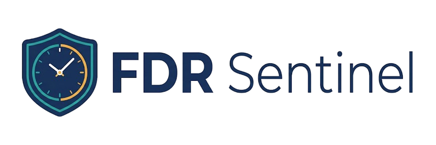
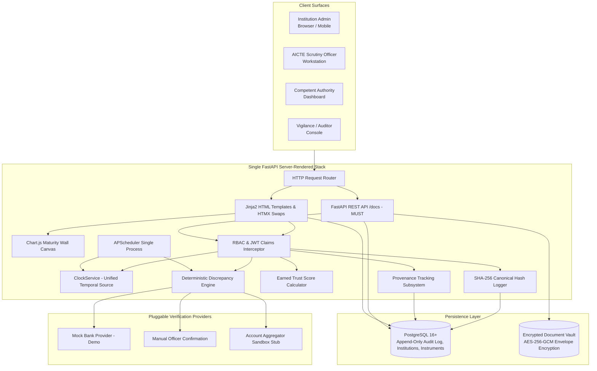

<div align="center">
  
  <p><strong>Intelligent Fixed Deposit & Security Deposit Lifecycle Management Portal for AICTE</strong><br/>
  <em>Smart India Hackathon (SIH) Entry — Problem Statement 26265 (AICTE, Regulation Bureau, Smart Automation)</em></p>
</div>

---

## 📌 The Problem
Technical education institutions seeking approval from the All India Council for Technical Education (AICTE) submit security deposits, primarily in the form of Fixed Deposit Receipts (FDRs) or bank guarantees. In traditional manual workflows, managing these deposits across numerous institutions involves:
* **Fragmented Physical & Spreadsheet Records:** High risk of clerical entry errors, misplaced documents, and lack of unified institution-wise tracking.
* **Lapse & Non-Renewal Risks:** Inability to track maturity horizons proactively, leading to expired FDRs without timely renewal or penalty escalation.
* **Verification Bottlenecks:** Difficulty in verifying authenticity with issuing bank branches, and inability to distinguish self-declared college claims from bank-confirmed facts.
* **Absence of Central Executive Visibility:** Regional and central leadership lack an aggregate view of deposits at risk, upcoming maturity tranches, or release liabilities.

---

## 💡 The Solution
**FDR Sentinel** transforms AICTE’s security deposit custody into an automated, tamper-detecting digital workflow:
1. **Digital Ingestion & Discrepancy Engine:** Ingests FDR documents, extracts text layers (with Tesseract OCR fallback), and flags 8 deterministic discrepancies (date inversions, deposit under-funding, cross-college duplicate receipt numbers, quarterly compounding math errors). Flagged submissions are preserved with status `DISCREPANCY_FLAGGED` to retain full audit trails.
2. **Field-Level Provenance:** Explicitly labels every data attribute as `SELF_DECLARED`, `OCR_EXTRACTED`, `MOCK_BANK_CONFIRMED` *(visibly marked as demo/simulated)*, `BANK_CONFIRMED` *(reserved for authorized live channels)*, or `OFFICER_VERIFIED`.
3. **Unified Time Handling & Proactive Escalation:** Driven by an injectable `ClockService` and a single-process scheduler, tracking 90/60/30/7-day horizons with bilingual (English/Hindi) notices, idempotent alert dispatch, and catch-up processing for time warps.
4. **Lineage-Tracked Renewals & Dual-Auth Release:** Maintains parent-child renewal lineage (parent becomes `RENEWED` only when the child reaches `ACTIVE`) and enforces a two-step human-in-the-loop release workflow (allowed from `ACTIVE`, `EXPIRING`, or `MATURED`) with statutory checklists and Ed25519-signed QR certificates.
5. **Executive Visibility & Tamper-Detecting Integrity:** Provides interactive regional maturity walls, "Deposit at Risk" exposure metrics, and a continuous SHA-256 cryptographic audit hash chain that detects unauthorized database modifications.

---

## 🚀 Feature Matrix & Build Priority

| Feature / Capability | Description | Priority Tier | Status |
| :--- | :--- | :---: | :---: |
| **Auth & RBAC Middleware** | 4 discrete roles, JWT sessions, and `is_demo_admin` flag. | **Tier 1** | `Completed (Stage 3)` |
| **Unified ClockService** | Injected singleton temporal authority for all logic and queries. | **Tier 1** | `Completed (Stage 2)` |
| **Tamper-Detecting Hash Chain** | SHA-256 canonical JSON chain with DB-level privilege revocation. | **Tier 1** | `Completed (Stage 2)` |
| **Encrypted Submission Vault** | AES-256-GCM envelope encryption with master KEK. | **Tier 1** | `Planned` |
| **11-State Finite State Machine** | Strict lifecycle transitions and non-destructive discrepancy flagging. | **Tier 1** | `Planned` |
| **Deterministic Discrepancy Rules** | Core checks (DISC-01 to DISC-06, DISC-08) including duplicate isolation. | **Tier 1** | `Planned` |
| **Scrutiny Officer Console** | HTMX-powered review workstation with anomaly indicators. | **Tier 1** | `Planned` |
| **Temporal Alerts & Scheduler** | APScheduler single-process worker, 90/60/30/7-day horizons, catch-up. | **Tier 2** | `Planned` |
| **Demo "Time Machine" Clock** | Dedicated toolbar for `is_demo_admin` when `DEMO_MODE=true`. | **Tier 2** | `Completed (Stage 3)` |
| **Maturity Wall & Risk Dashboard** | Executive Chart.js visualization of deposits at risk and monthly tranches. | **Tier 2** | `Planned` |
| **Earned Trust Score Calculator** | Low base (20) + evidence additions - rule deductions (0–100). | **Tier 2** | `Planned` |
| **Bilingual Official Notices** | English and Hindi notice templates for official communication. | **Tier 2** | `Planned` |
| **Renewal Lineage Chain** | Parent-child rollover graph; parent renews only when child is active. | **Tier 3** | `Planned` |
| **Dual-Authorized Release Workflow**| Human-in-the-loop scrutiny checklist + authority sign-off. | **Tier 3** | `Planned` |
| **Audit Verification & Tamper Test**| Linear-time chain verifier with live database tamper test. | **Tier 3** | `Completed (Stage 3)` |
| **Seed Script & Deployment** | Multi-institution synthetic seed dataset, Docker Compose orchestration. | **Tier 3** | `Completed (Stage 3)` |
| **Backup Demo Video** | Full 5-minute judge walkthrough recorded as backup deliverable. | **Tier 3** | `Planned` |
| **Text Extraction / OCR Diff Viewer**| Native PDF text layer with Tesseract OCR fallback and visual diff. | **Tier 4** | `Planned` |
| **QR-Verifiable Deposit Certificate**| Ed25519-signed public certificate omitting private bank secrets. | **Tier 4** | `Planned` |
| **Explainable Lapse-Risk Ranking** | Urgency-weighted advisory ranking: `urgency * amount * (1 / trust)`. | **Tier 4** | `Planned` |
| **Compliance Export Reports** | CSV and printable PDF report generation. | **Tier 4** | `Planned` |
| **Interactive OpenAPI 3.1 Docs** | Full interactive REST documentation (`/docs`). | **Tier 4 (MUST)** | `Completed (Stage 1)` |
| **Outbound Webhooks & AA Stub** | Webhook notifications & Account Aggregator sandbox blueprint. | **Tier 4 (STRETCH)**| `Planned` |

---

## 🏗️ Architecture



---

## 🛠️ Tech Stack
* **Full-Stack Application:** Single FastAPI application (Python 3.11, Pydantic v2, synchronous SQLAlchemy 2.0 with `psycopg`, PyJWT, Cryptography, Bcrypt) serving both HTML views and REST endpoints.
* **UI & Interactivity:** Jinja2 templates + HTMX (dynamic, SPA-like partial DOM updates without client build pipelines) + Tailwind CSS + Lucide Icons. Local vendored static assets (`htmx.min.js`, `tailwind.min.js`) ensure 100% offline evaluation capability.
* **Visualizations:** Chart.js (rendered on native HTML5 canvas for the Maturity Wall and regional risk exposure).
* **Database & Roles:** PostgreSQL 16+ with strict role segregation: administrative migrations and seeding run under `fdr_owner`; application runtime executes strictly under `fdr_app_user` with `UPDATE`, `DELETE`, and `TRUNCATE` revoked on `audit_log`. Separate `fdr_sentinel_test` database for automated tests.
* **Scheduler:** APScheduler 3.x (Single-process worker executing scans against `ClockService`).
* **Security & Crypto:** `cryptography` (AES-256-GCM envelope encryption with master KEK, Ed25519 certificate signatures, SHA-256 canonical hash chains, Bcrypt password hashing with constant-time dummy timing mitigation, double-submit cookie CSRF).
* **Document Processing:** PDF digital text-layer extraction (`pypdf` / `pdfplumber`) with Tesseract OCR fallback for scanned images.
* **Containerization:** Docker & Docker Compose (single application container `fdr_sentinel_web` + PostgreSQL container `fdr_sentinel_db`).

---

## 📁 Project Structure

```text
FDR-SENTINEL/
├── .gitignore                      # Tracked exclusions (python, secrets, volumes)
├── README.md                       # High-level overview, architecture, & disclosures
├── SPEC.md                         # Detailed system specification with MVP Addendum
├── PROGRESS.md                     # Day-by-day roadmap, phase tracker, & decisions log
├── docker-compose.yml              # Container orchestration (FastAPI + PostgreSQL)
├── app/                            # Unified FastAPI Application
│   ├── core/                       # Security, config, dependencies, database session
│   ├── models/                     # SQLAlchemy ORM models (User, Institution, Instrument, Audit, Clock)
│   ├── routers/                    # Health, auth, demo, pages, REST API
│   ├── schemas/                    # Pydantic v2 validation contracts
│   ├── services/                   # ClockService, AuditService, DiscrepancyEngine, TrustScore
│   ├── static/                     # Vendored HTMX, Tailwind, cropped brand icons, favicons
│   └── templates/                  # Jinja2 templates (Base, Auth, Roles, Time Machine, Errors)
├── tests/                          # Automated test suite (76 tests: auth, rbac, csrf, clock, audit, ui)
├── scripts/                        # DB init, branding cropper, idempotent seed_users script
├── storage/                        # (Local Only) Encrypted document vault
└── requirements.txt
```

---

## 💻 Setup and Run Instructions

### 1. Prerequisites
* **Docker Desktop** (with Linux containers enabled)
* **Git** and PowerShell (or bash)

### 2. Launch the Application Stack
```powershell
# Clone and enter the repository directory
cd FDR-SENTINEL

# Start PostgreSQL and FastAPI containers in detached mode
docker compose up -d

# Verify services are healthy
docker compose ps
```
The services will be available at:
* **Web Portal & Login:** [http://localhost:8000/login](http://localhost:8000/login)
* **Interactive API Documentation:** [http://localhost:8000/docs](http://localhost:8000/docs)
* **Health Check Probe:** [http://localhost:8000/healthz](http://localhost:8000/healthz)
* **Cryptographic Audit Verification:** [http://localhost:8000/audit/verify](http://localhost:8000/audit/verify)

### 3. Seed Database with Demo Accounts
Run the idempotent seeding script inside the running web container. Provide a strong seed password (minimum 12 characters):
```powershell
docker compose exec -e SEED_PASSWORD=DevSeedPassword2026! web python scripts/seed_users.py
```

### 4. Demo Evaluation User Credentials

| Username | Role | Assigned Entity / Context | Password | Capabilities |
| :--- | :--- | :--- | :--- | :--- |
| `demo.admin` | `AUDITOR` (`is_demo_admin=true`) | Hackathon Jury / Demo Administrator | `DevSeedPassword2026!` | Full evaluation access, Demo Time Machine controls, audit verification |
| `scrutiny.officer` | `SCRUTINY_OFFICER` | AICTE Scrutiny Officer | `DevSeedPassword2026!` | Scrutiny review console, discrepancy inspection, verification |
| `approver.authority` | `APPROVER_AUTHORITY` | AICTE Approval Bureau Head | `DevSeedPassword2026!` | Competent authority workstation, deposit release authorization |
| `auditor` | `AUDITOR` | Central Vigilance / Chief Auditor | `DevSeedPassword2026!` | Cryptographic chain verification, audit trail inspection |
| `inst.admin` | `INSTITUTION_ADMIN` | Delhi Technological University | `DevSeedPassword2026!` | College FDR portal, submission uploads, status tracking |
| `inst.admin2` | `INSTITUTION_ADMIN` | Sardar Patel Institute of Technology | `DevSeedPassword2026!` | Isolated second institution (tests boundary and isolation) |

### 5. Running the Test Suite
The automated test suite executes strictly against the isolated test database (`fdr_sentinel_test`), never modifying development records:
```powershell
docker compose exec web pytest -q
```
*Current test suite: **76 passed** (including static temporal integrity checks, constant-time dummy timing mitigation, CSRF double-submit tests, and institution tenancy scoping).*

---

## 🎬 5-Minute Evaluation Walkthrough
1. **Executive Command:** Open Dashboard as Scrutiny Officer to review active FDR status counters, regional distribution, and the interactive **Maturity Wall** displaying expiring deposits for the upcoming quarter based on the loaded seed dataset.
2. **Discrepancy Identification & Earned Trust:** Switch to Institution portal. Upload an FDR with inverted dates and a duplicate receipt number. The system preserves the record as `DISCREPANCY_FLAGGED` without crashing. Reveal the **Explainable Trust Score**: Base (20) + Valid PDF (15) - Chronological Inversion DISC-02 (40) - Duplicate Submission DISC-05 (50) = 0/100 (clamped). Note that the incumbent college's existing deposit remains untouched in `ACTIVE` status.
3. **Demo Time Machine Clock & Catch-Up Alerts:** Advance the injected application clock by 60 days via the Demo Time Machine toolbar (available to `is_demo_admin` when `DEMO_MODE=true`). Watch the single-process scheduler fire live: status shifts from `ACTIVE` to `EXPIRING`, catch-up evaluation dispatches bilingual English/Hindi notices, and an urgent Tier 2 escalation appears on the officer backlog.
4. **Renewal Lineage & Dual-Authorized Release:** Demonstrate parent-child renewal lineage, where parent FDR becomes `RENEWED` only when child reaches `ACTIVE`. Switch to Competent Authority account. Open a release request filed from a `MATURED` instrument. Inspect the officer's statutory checklist and evidence. Click **Authorize Release** to produce an Ed25519-signed QR certificate.
5. **Tamper-Detection Live Test:** Open Auditor view. Click **Verify Chain Integrity**; show green confirmation. Run a test script that directly modifies a database audit row; re-run verification; watch the indicator turn RED, pinpointing the exact compromised block ID.

---

## ⚖️ Limitations & Honest Disclosures
* **Simulated Data:** All institutional names, FDR numbers, and rupee values in the prototype are synthetically generated for demonstration.
* **Mocked Banking APIs:** There is **no live connection to commercial bank CBS or production banking networks**. Real bank verification requires formal bilateral MoUs and regulatory clearances; the prototype employs a simulated mock bank provider and manual confirmation workflows.
* **No Direct Fund Disbursements:** The portal governs legal custody and regulatory authorization; it does not process direct wire transfers or NEFT/RTGS payouts.
* **Assumptions to Verify:** Specific business rules (such as deposit slabs per discipline, joint-account wording, regional office boundaries, and penal withholding rules) represent **assumptions to verify** against the prevailing AICTE Approval Process Handbook (APH).
* **Regulatory Design Alignment:** The system architecture is designed to reflect the principles of India’s **Digital Personal Data Protection (DPDP) Act 2023**, but carries no formal statutory or security certifications.

---

## 👥 Team & License
* **Developer:** *Solo Developer Build (SIH Entry 2026)*
* **Problem Statement:** 26265 (AICTE, Regulation Bureau, Smart Automation)
* **License:** *To be specified upon formal repository submission (e.g., MIT License)*
