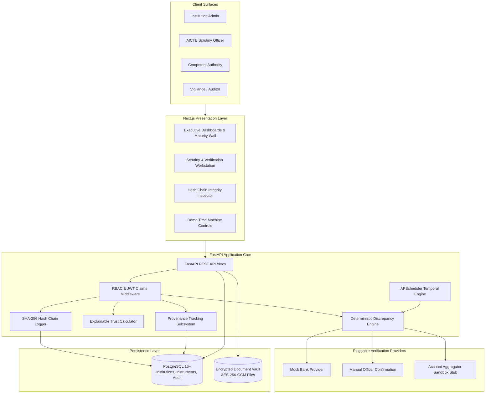

# FDR Sentinel 🛡️
> **Intelligent Fixed Deposit & Security Deposit Lifecycle Management Portal for AICTE**  
> *Smart India Hackathon (SIH) Entry — Problem Statement 26265 (AICTE, Regulation Bureau, Smart Automation)*

---

## 📌 The Problem
Technical education institutions seeking approval from the All India Council for Technical Education (AICTE) are mandated to submit security deposits, primarily in the form of Fixed Deposit Receipts (FDRs) or bank guarantees. In traditional workflows, managing these deposits across thousands of colleges involves:
* **Fragmented Physical & Spreadsheet Records:** High risk of clerical entry errors, misplaced documents, and lack of institution-wise tracking.
* **Lapse & Non-Renewal Risks:** Inability to track maturity horizons proactively, leading to expired FDRs without timely renewal or penalty escalation.
* **Verification Bottlenecks:** Difficulty in verifying authenticity with issuing bank branches, and inability to distinguish self-declared college claims from bank-confirmed facts.
* **Absence of Central Executive Visibility:** Regional and central leadership lack an aggregate view of deposits at risk, upcoming maturity tranches, or release liabilities.

---

## 💡 The Solution
**FDR Sentinel** transforms AICTE’s security deposit custody into an automated, tamper-evident digital workflow:
1. **Digital Ingestion & Discrepancy Engine:** Ingests FDR documents, runs OCR extraction, and immediately flags 8+ deterministic discrepancies (date inversions, deposit under-funding, cross-college duplicate receipt numbers, math errors).
2. **Field-Level Provenance:** Explicitly labels every data attribute as `SELF_DECLARED`, `OCR_EXTRACTED`, `BANK_CONFIRMED`, or `OFFICER_VERIFIED`.
3. **Automated Maturity & Escalation Engine:** Tracks 90/60/30/7-day horizons with bilingual (English/Hindi) notices and a 3-tier escalation ladder.
4. **Lineage-Tracked Renewals & Dual-Auth Release:** Maintains complete parent-child renewal chains and enforces a two-step human-in-the-loop authorization workflow for release requests.
5. **Executive Visibility & Tamper-Evident Integrity:** Provides interactive regional maturity walls, "Deposit at Risk" exposure metrics, and a continuous SHA-256 cryptographic audit hash chain.

---

## 🚀 Feature Matrix

| Feature / Capability | Description | Status |
| :--- | :--- | :---: |
| **Institution & Instrument Ledger** | Multi-institution directory with branch, IFSC, and tenure tracking. | `Planned` |
| **Deterministic Discrepancy Engine** | 8 automated financial, date, and duplicate receipt checks. | `Planned` |
| **Field-Level Provenance Tracking** | 4-tier origin tagging across form inputs and verified values. | `Planned` |
| **Temporal Alerts & Escalations** | Configurable 90/60/30/7-day reminder cadence with 3-tier escalation. | `Planned` |
| **Renewal Lineage Chain** | Full versioning and parent-child linking for renewed deposits. | `Planned` |
| **Dual-Authorized Release Workflow**| Human-in-the-loop scrutiny recommendation + authority sign-off. | `Planned` |
| **Maturity Wall & Risk Dashboard** | Executive visualization of deposits at risk and monthly tranches. | `Planned` |
| **Explainable Trust Score** | Rule-based 0–100 score per instrument with transparent breakdown. | `Planned` |
| **Tamper-Evident Audit Hash Chain** | SHA-256 continuous block hashing with `/verify` endpoint. | `Planned` |
| **Bilingual Official Notices** | Automated English and Hindi notice generator for colleges. | `Planned` |
| **QR-Verifiable Deposit Certificate**| Publicly verifiable status certificate without exposing secret keys. | `Planned` |
| **Demo "Time Machine" Clock** | Evaluator toolbar to simulate future dates (+30d, +60d, +1y). | `Planned` |
| **Pluggable Verification Interface** | Strategy pattern supporting mock bank, manual letter, & AA stubs. | `Planned` |

---

## 🏗️ Architecture



---

## 🛠️ Tech Stack
* **Frontend:** Next.js 14+ (React, TypeScript, Tailwind CSS, Lucide Icons, Shadcn UI)
* **Backend:** FastAPI (Python 3.11+, Pydantic v2, SQLAlchemy 2.0 Async, PyJWT)
* **Database:** PostgreSQL 16+ (Relational schema, JSONB metadata, B-tree indices)
* **Scheduler:** APScheduler 3.x (Async temporal scheduling for reminder checks & time warp)
* **Security & Crypto:** `cryptography` (AES-256-GCM file encryption, SHA-256 hash chains)
* **Document OCR:** Tesseract / easyOCR wrapper + `pypdf` metadata inspector
* **Containerization:** Docker & Docker Compose

---

## 📁 Project Structure (Planned)

```text
FDR-SENTINEL/
├── .gitignore                      # Tracked exclusions (node, python, secrets, volumes)
├── README.md                       # High-level overview, architecture, & disclosures
├── SPEC.md                         # Detailed system specification & traceability matrix
├── PROGRESS.md                     # Roadmap, phase progress checklist, & decisions log
├── docker-compose.yml              # (Planned) Container orchestration
├── frontend/                       # (Planned) Next.js 14 Web Application
│   ├── src/
│   │   ├── app/                    # App Router pages (Dashboard, Scrutiny, Audit, Time Machine)
│   │   ├── components/             # Reusable UI widgets, Maturity Wall, Trust Score Card
│   │   └── lib/                    # API clients, auth helpers, types
│   ├── package.json
│   └── tsconfig.json
├── backend/                        # (Planned) FastAPI Application Service
│   ├── app/
│   │   ├── api/                    # REST endpoints (auth, instruments, scrutiny, audit)
│   │   ├── core/                   # Security, configuration, AES encryption
│   │   ├── models/                 # SQLAlchemy ORM models
│   │   ├── schemas/                # Pydantic v2 validation contracts
│   │   ├── services/               # Discrepancy engine, trust score, hash chainer
│   │   └── providers/              # Pluggable verification providers (Mock, Manual, AA)
│   ├── tests/                      # Automated test suite (6 evaluation scenarios)
│   └── requirements.txt
└── storage/                        # (Planned, Local Only) Encrypted document vault
```

---

## 💻 Setup and Run Instructions
> **Notice:** The setup, environment configuration, database migration, and startup commands will be written here once implementation begins. No application code or dependencies have been installed yet.

---

## 🎬 5-Minute Evaluation Walkthrough
1. **Executive Command:** Open Dashboard to review active FDR volume, regional breakdown, and the interactive **Maturity Wall** highlighting ₹42.5 Cr in impending maturities.
2. **Discrepancy Identification:** Switch to Institution view. Upload an intentionally defective FDR (inverted maturity date and duplicate receipt number). Observe the **Discrepancy Engine** immediately flag violations and calculate a low Trust Score.
3. **Demo Time Machine:** Jump forward +60 days in the evaluator toolbar. Watch APScheduler fire live: notice letters dispatched, status shifted to `EXPIRING`, and Tier 2 urgent escalation assigned to the officer backlog.
4. **Renewal & Dual-Auth Release:** Showcase parent-child renewal lineage. Log in as Competent Authority, inspect scrutiny checklist, and authorize a verified deposit release with a generated digital certificate.
5. **Cryptographic Audit Chain:** Open Auditor view. Run `/api/v1/audit/verify` to demonstrate SHA-256 hash chain verification across all historical events.

---

## ⚖️ Limitations & Honest Disclosures
* **Simulated Data:** All institutional names, FDR numbers, and rupee values in the prototype are synthetically generated for demonstration.
* **Mocked Banking APIs:** There is **no live connection to commercial bank CBS or production banking networks**. Real bank verification requires formal bilateral MoUs and regulatory clearances; the prototype employs a simulated mock bank provider and manual confirmation workflows.
* **No Direct Fund Disbursements:** The portal governs legal custody and regulatory authorization; it does not process direct wire transfers or NEFT/RTGS payouts.
* **Regulatory Design Alignment:** The system architecture is designed to reflect the principles of India’s **Digital Personal Data Protection (DPDP) Act 2023** and AICTE’s Approval Process Handbook (APH), but carries no formal statutory or security certifications.

---

## 👥 Team & License
* **Team:** *SIH 2024/2025/2026 Participant Team (Placeholder)*
* **Problem Statement:** 26265 (AICTE, Regulation Bureau)
* **License:** *To be specified upon formal repository submission (e.g., MIT License)*
