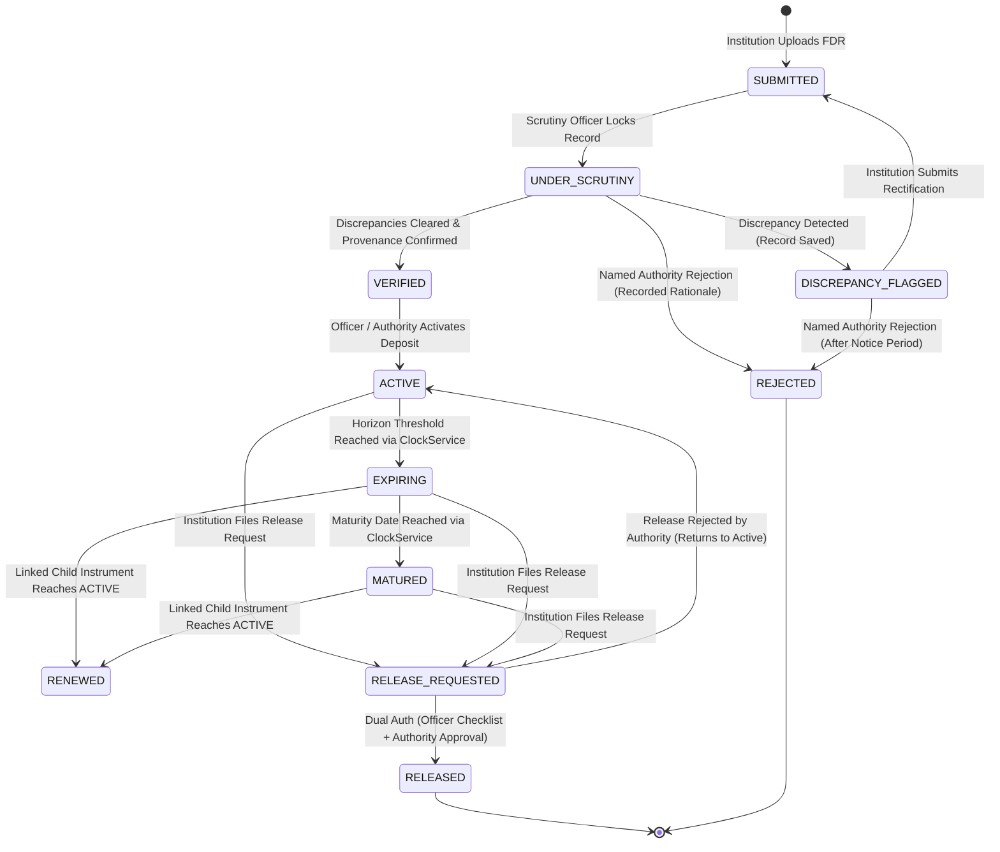
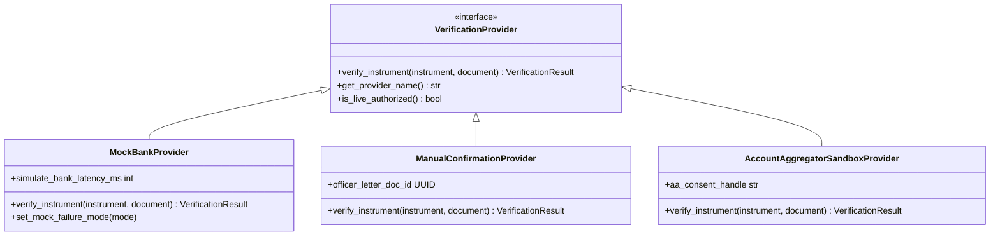
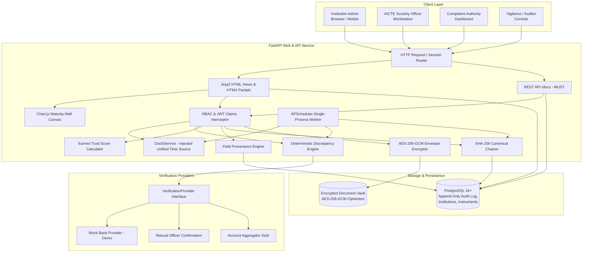

# MVP ADDENDUM (AUTHORITATIVE)
> **Precedence Rule:** Where any statement in this addendum conflicts with the remainder of this specification or previous revisions, this addendum strictly supersedes and governs the implementation.

### 1. Delivery Context & Unified Tech Stack (Next.js Replaced)
* **Delivery Window:** 24 Oct 2026 to 28 Oct 2026 (4 build days from 24 Oct, feature freeze evening of 27 Oct, final testing & submission 28 Oct).
* **Team Structure:** Solo developer implementing all planned capabilities without scope cuts.
* **Architecture:** To eliminate decoupled API-client synchronization overhead and multi-container build complexity, the separate Next.js frontend is **fully replaced by a unified, server-rendered application stack**:
  * **Backend & Web Server:** Single FastAPI application (Python 3.11+) serving both REST API endpoints and server-rendered HTML.
  * **Templating & Interactivity:** Jinja2 templates + HTMX (providing declarative, SPA-like partial DOM swaps, modals, inline status updates, and tabs without complex client build pipelines).
  * **Styling & Assets:** Tailwind CSS + Lucide Icons.
  * **Client Visualizations:** Chart.js (rendered on native HTML5 canvas for the Maturity Wall and regional risk distributions).
  * **Persistence Layer:** PostgreSQL 16+ (relational schema, JSONB, append-only audit log).
  * **Orchestration:** Docker Compose (single combined application container + PostgreSQL container).

### 2. Strict Tiered Build Priority (No Feature Cuts)
All capabilities in the specification will be constructed. Lower tiers are built sequentially after higher tiers are functional:
* **Tier 1 (Core Regulatory Loop):** Authentication & RBAC middleware, `ClockService`, hash-chained audit log with canonical JSON serialization, FDR submission with AES-256-GCM envelope-encrypted upload, 11-state finite state machine (FSM), deterministic discrepancy rules (`DISC-01` to `DISC-06`, `DISC-08`), Scrutiny Officer workstation console.
* **Tier 2 (Temporal Engine, Visibility & Notices):** APScheduler single-process worker, proactive alert dispatch & catch-up logic, Demo Time Machine clock controller, Executive Dashboard & Chart.js Maturity Wall, earned Trust Score calculator, bilingual (English/Hindi) official notice templates.
* **Tier 3 (Lifecycle Completion, Integrity & Deployment):** Parent-child renewal chain, dual-key release workflow (officer checklist + authority sign-off), audit verification page with live tamper detection test, 50-record synthetic seed script, Docker Compose deployment, backup demo video recording.
* **Tier 4 (Advanced Automation & Integration Extensions):** PDF text extraction with Tesseract OCR fallback and side-by-side diff viewer (`DISC-07`), Ed25519-signed QR certificate generation, explainable lapse-risk backlog sorting, CSV/PDF report export, OpenAPI 3.1 interactive docs, outbound webhooks, Account Aggregator sandbox stub.

### 3. Binding Engineering Clarifications
1. **Trust Score & Text Extraction:** Trust-score components that depend on text extraction (the +20 normalized match bonus and DISC-07 deduction) contribute 0 points until text extraction is implemented in Tier 4.
2. **Mock Bank in Demo Mode:** In demo mode (`DEMO_MODE=true`), `MOCK_BANK_CONFIRMED` earns the full +30 bank-confirmation trust score addition. The UI explicitly labels the score with: *"Includes simulated confirmation (Demo)"*.
3. **Audit Log Hash Binding:** The canonical JSON payload hashed into $H_n$ must explicitly include the record's `id`, `event_timestamp`, `entity_type`, `entity_id`, `action`, `actor_user_id`, and `actor_role` so that tampering with any of these metadata fields immediately breaks the hash chain.
4. **Database Roles & Permissions:** Database migrations (Alembic) and synthetic seeding scripts execute under the administrative DB owner role (`fdr_owner`). The application runtime executes strictly under the restricted `fdr_app_user` role, which has `INSERT` and `SELECT` privileges on `audit_log`, with `UPDATE`, `DELETE`, and `TRUNCATE` revoked at the PostgreSQL engine level. A dedicated test database `fdr_sentinel_test` is used for automated testing, ensuring test suites never touch the development database.
5. **Deployed Demo Mode:** The deployed demonstration instance runs with `DEMO_MODE=true` set in its environment, enabling Time Machine clock controls for authenticated users where `is_demo_admin = true`.

---

# FDR Sentinel: System Specification (SPEC.md)
**Project Title:** FDR Sentinel — Intelligent Fixed Deposit & Security Deposit Lifecycle Management Portal  
**Problem Statement:** SIH 26265 (AICTE, Regulation Bureau, Smart Automation)  
**Document Revision:** 1.2.0 (Authoritative MVP Addendum Integrated)  
**Target Audience:** AICTE Regulation Bureau, SIH Evaluation Jury, Development Team  

---

## 1. Vision, Scope, and Explicit Non-Goals

### 1.1 Vision
FDR Sentinel provides a unified, tamper-detecting, and automated portal for the All India Council for Technical Education (AICTE) to govern the complete lifecycle of institutional security deposits (primarily Fixed Deposit Receipts — FDRs) submitted by technical education institutions. It shifts AICTE from error-prone, manual physical record-keeping to a proactive, rules-assisted digital custody model.

### 1.2 Core Scope (Prototype)
* **Digital Custody & Verification:** Ingestion of FDR submissions with automated anomaly detection, PDF text-layer extraction with Tesseract OCR fallback, and structured multi-source provenance.
* **Proactive Validity Management:** Automated maturity horizon monitoring using a unified Clock service, configurable multi-channel reminder scheduling, and hierarchical escalation for impending or lapsed deposits.
* **Lifecycle Governance:** End-to-end state transitions spanning submission, scrutiny, discrepancy flagging, verification, renewal tracking, and dual-authorized release.
* **Executive Visibility:** Real-time dashboards displaying regional maturity walls, exposure-at-risk, and portfolio health metrics.
* **Integrity & Compliance:** Cryptographic SHA-256 audit hash chains with tamper-detection, AES-256-GCM envelope encryption at rest, and role-based access control aligned with Indian data protection principles.

### 1.3 Explicit Non-Goals
To preserve regulatory compliance, realistic engineering boundaries, and technical honesty during the hackathon evaluation, the following are **explicit non-goals** for the prototype:
1. **No Live Bank Integration:** The prototype **does not connect to production banking APIs or core banking systems (CBS)**. Direct bank verification requires statutory clearances, NPCI/RBI approvals, and formal bilateral MoUs with commercial banks. All demo verification utilizes a pluggable mock bank adapter or manual scrutiny workflows.
2. **No Autonomous Officer Replacement:** The system **never takes unilateral legal or administrative decisions**. Algorithms only provide decision support, anomaly flags, and advisory risk scores. Instrument acceptance, rejection, forfeiture, and release mandate named human officer authorization.
3. **No Direct Financial Disbursement / Payment Gateway:** The portal manages security deposit custody records and release authorizations. It does not transfer funds or execute online banking transactions.
4. **No Unwarranted Statutory Certifications:** The prototype is designed in architectural alignment with the Digital Personal Data Protection (DPDP) Act 2023 and ISO/IEC 27001 principles, but **claims no formal certifications** (e.g., CERT-In empanelled audit, ISO certification).
5. **No Production AICTE Portal Overhaul:** The prototype delivers a self-contained microservice and standalone portal exposing documented OpenAPI endpoints, designed for future single-sign-on (SSO) and API-level federation with AICTE's existing Approval Process portal.

---

## 2. Requirements Traceability Matrix

The table below maps the 10 mandated capabilities from Problem Statement 26265 to the architectural components, functional features, and specification sections within FDR Sentinel. All items represent planned architectural capabilities for the implementation phase.

| ID | Mandatory Capability (Problem Statement 26265) | Satisfying Feature / Module | SPEC Section | Implementation Status |
| :--- | :--- | :--- | :--- | :---: |
| **REQ-01** | **Institution-wise and instrument-wise records:** Central record-keeping (reference numbers, bank, amount, issue date, maturity date, status, documents). | Institution Ledger & Instrument Vault (`Instrument`, `Institution` models with version history). | Section 5.1, 5.2 | `Planned` |
| **REQ-02** | **Verification of submissions and discrepancy flagging:** Automated validation & anomaly identification distinguishing invalid submissions. | Automated Rule Engine (`DiscrepancyEngine`) executing deterministic financial and integrity checks. | Section 7.0 | `Planned` |
| **REQ-03** | **Distinguishing submitted vs. confirmed information:** Field-level provenance tracking (self-declared vs. bank-confirmed or officer-verified). | Provenance Tracking Subsystem (`ProvenanceRecord` linking entity, field, value, source, timestamp). | Section 5.3, 6.2 | `Planned` |
| **REQ-04** | **Tracking maturity and validity with configurable reminders and escalation:** Proactive alert schedules and overdue escalation. | Temporal Engine (`APScheduler` single-process worker + `ClockService` + `EscalationManager`). | Section 6.3, 8.0 | `Planned` |
| **REQ-05** | **Tracking renewals and replacements with full history:** Lineage graph and parent-child version chains across rollovers. | Lineage Graph & Version Chains (`previous_instrument_id`, `renewal_seq`, linked lifecycle states). | Section 4.2, 5.2 | `Planned` |
| **REQ-06** | **Release and refund requests subject to authorization by competent authority:** Multi-tier verification and sign-off workflow. | Multi-tier Release Approval Workflow with officer checklist evidence and authority digital sign-off. | Section 4.3, 10.0 | `Planned` |
| **REQ-07** | **Central dashboard of active, expiring, matured, renewed, released and pending instruments:** Real-time visibility and status tracking. | Analytical Command Center (`FastAPI + Jinja2 + HTMX + Chart.js` role-tailored dashboard with status filters and aggregations). | Section 9.2, 12.0 | `Planned` |
| **REQ-08** | **Production of reports:** Generation of compliance reports, regional summaries, and exposure analytics. | Dynamic Report Generator (PDF/CSV export, compliance status summaries, regional maturity distribution). | Section 9.2, 12.2 | `Planned` |
| **REQ-09** | **Digital Document Management, role-based access, and audit trail:** Encrypted storage, strict RBAC, and tamper-detecting audit log. | Security Subsystem (FastAPI RBAC middleware, AES-256-GCM envelope encryption, SHA-256 hash chain). | Section 3.0, 9.4, 11.0 | `Planned` |
| **REQ-10** | **System integration and bank verification (where feasible and authorized):** Pluggable bank verification and central AICTE integration. | Pluggable `VerificationProvider` architecture, Mock Bank adapter, AA sandbox blueprint, OpenAPI 3.1. | Section 6.1, 9.8, 12.0 | `Planned (Mock Bank & AA Blueprint)` |

---

## 3. Roles and Permissions Matrix

FDR Sentinel enforces strict Role-Based Access Control (RBAC). Roles are segregated across administrative and operational tiers, with a dedicated evaluation flag for testing environments.

| Operational Action / Capability | Institution User (`INSTITUTION_ADMIN`) | AICTE Scrutiny Officer (`SCRUTINY_OFFICER`) | Competent Authority (`APPROVER_AUTHORITY`) | System Auditor (`AUDITOR`) | Demo Administrator (`is_demo_admin = true`) |
| :--- | :---: | :---: | :---: | :---: | :---: |
| **Submit New FDR Instrument / Details** | **CREATE** | View Only | View Only | View Only | No Access |
| **Upload Instrument Scans & Documents** | **CREATE** | View Only | View Only | View Only | No Access |
| **View Own Institution's Instruments** | **READ** | View All | View All | View All | View All |
| **Initiate Instrument Renewal Submission** | **CREATE** | View Only | View Only | View Only | No Access |
| **Initiate Release / Refund Request** | **CREATE** (from Active/Expiring/Matured) | View Only | View Only | View Only | No Access |
| **Run Text Extraction & Discrepancy Checks** | Automated Trigger | **EXECUTE** | View Results | View Results | View Results |
| **Add Internal Scrutiny Notes & Checklist Evidence** | No Access | **CREATE / READ** | **READ** | **READ** | View Only |
| **Flag Discrepancy (Return to College)** | No Access | **EXECUTE** | View Only | View Only | No Access |
| **Verify Instrument (Under Scrutiny -> Verified)**| No Access | **EXECUTE** | View Only | View Only | No Access |
| **Activate Verified Deposit (`Verified -> Active`)** | No Access | **EXECUTE** | **EXECUTE** | View Only | No Access |
| **Authorize Instrument Release / Refund** | No Access | Recommend Only | **FINAL APPROVAL** | View Only | No Access |
| **Reject Instrument / Reject Release Request** | No Access | Recommend Only | **FINAL APPROVAL** | View Only | No Access |
| **Inspect Tamper-Detection Hash Chain** | No Access | View Status | View Status | **FULL AUDIT & VERIFY** | View Status |
| **Export Regulatory Reports & Exposure Walls** | Own College Only | Assigned Region | AICTE-Wide | AICTE-Wide | AICTE-Wide |
| **Operate Demo Time Machine Clock** | No Access | No Access | No Access | No Access | **EXECUTE (DEMO_MODE only)** |

---

## 4. Instrument Lifecycle and State Transitions

### 4.1 State Machine
Every security deposit receipt is treated as a finite-state machine (FSM). The allowable states are:
1. `SUBMITTED`: Uploaded by the institution; record created, awaiting scrutiny.
2. `UNDER_SCRUTINY`: Locked for officer review; automated discrepancy checks executed.
3. `DISCREPANCY_FLAGGED`: Validation engine or officer detected defects; preserved in database with attached discrepancy tickets and returned to institution for rectification.
4. `VERIFIED`: Discrepancies cleared, provenance verified (bank confirmation letter validated or mock confirmation passed).
5. `ACTIVE`: Formally accepted into AICTE custody as a valid security deposit.
6. `EXPIRING`: System-flagged maturity window (within 90/60/30/7 days of maturity date according to `ClockService`).
7. `MATURED`: Reached or exceeded maturity date without confirmed renewal; alert status high.
8. `RENEWED`: Parent deposit rolled over; an instrument enters `RENEWED` **only when its linked child instrument transitions to `ACTIVE`**.
9. `RELEASE_REQUESTED`: Institution filed security deposit return request (allowed from `ACTIVE`, `EXPIRING`, or `MATURED`).
10. `RELEASED`: Final release approval granted by Competent Authority; deposit discharged and sealed.
11. `REJECTED`: Submission formally rejected by named Competent Authority with recorded rationale (never automated).

### 4.2 State Transition Matrix

### 4.3 Transition Audit Logging Rule
For every state change, the system writes an immutable audit record containing:
* `instrument_id`, `from_state`, `to_state`, `actor_user_id`, `actor_role`, `timestamp` (UTC ISO 8601).
* Canonical JSON payload hash (`SHA-256`) linked to the preceding entry hash.
* Mandatory text justification or scrutiny note.

---

## 5. Data Model

The data layer is implemented in PostgreSQL using relational tables with JSONB fields for extensible field provenance and audit metadata.

### 5.1 Institutions Table (`institutions`)
* `id` (UUID, Primary Key)
* `aicte_permanent_id` (VARCHAR(50), Unique, Indexed) — e.g., `"1-10972341"`
* `name` (VARCHAR(255))
* `region` (VARCHAR(50), Indexed) — *[ASSUMPTION TO VERIFY - APH Norm]*: e.g., `"Northern"`, `"Western"`, `"South-Western"`, `"Central"`, `"Eastern"`, `"North-Western"`, `"Southern"`, `"South-Central"`
* `state` (VARCHAR(50))
* `address` (TEXT)
* `contact_email` (VARCHAR(150))
* `contact_phone` (VARCHAR(20))
* `institution_type` (VARCHAR(50)) — *[ASSUMPTION TO VERIFY - APH Norm]*: e.g., `"Engineering & Technology"`, `"Management"`, `"Pharmacy"`, `"Architecture"`, `"Polytechnic"`
* `created_at`, `updated_at` (TIMESTAMP WITH TIME ZONE)

### 5.2 Instruments Table (`instruments`)
* `id` (UUID, Primary Key)
* `institution_id` (UUID, Foreign Key -> `institutions.id`, Indexed)
* `fdr_number` (VARCHAR(100), Indexed)
* `bank_name` (VARCHAR(150), Indexed)
* `bank_branch` (VARCHAR(150))
* `ifsc_code` (VARCHAR(20))
* `principal_amount` (NUMERIC(14, 2))
* `maturity_amount` (NUMERIC(14, 2))
* `interest_rate_percent` (NUMERIC(5, 2))
* `issue_date` (DATE)
* `maturity_date` (DATE, Indexed)
* `tenure_months` (INTEGER)
* `joint_account_holder` (VARCHAR(255)) — *[ASSUMPTION TO VERIFY - APH Norm]*: Standard format: `"Regional Officer, AICTE & Chairman/Secretary, [College Name]"`
* `status` (VARCHAR(30), Indexed) — `SUBMITTED`, `ACTIVE`, `DISCREPANCY_FLAGGED`, etc.
* `previous_instrument_id` (UUID, Foreign Key -> `instruments.id`, Nullable) — Identifies parent in renewal chain.
* `renewal_sequence` (INTEGER, Default 1)
* `trust_score` (INTEGER, Range 0-100)
* `trust_score_breakdown` (JSONB)
* `created_at`, `updated_at` (TIMESTAMP WITH TIME ZONE)

### 5.3 Field-Level Provenance Table (`field_provenance`)
Tracks the origin and verification certainty of every individual data point.
* `id` (UUID, Primary Key)
* `instrument_id` (UUID, Foreign Key -> `instruments.id`)
* `field_name` (VARCHAR(50)) — e.g., `"maturity_date"`, `"principal_amount"`
* `submitted_value` (TEXT)
* `current_value` (TEXT)
* `provenance_type` (VARCHAR(30)) — `SELF_DECLARED`, `OCR_EXTRACTED`, `MOCK_BANK_CONFIRMED` *(visibly marked as demo/simulated)*, `BANK_CONFIRMED` *(reserved for live bank channels)*, `OFFICER_VERIFIED`
* `verified_by_user_id` (UUID, Nullable)
* `verified_at` (TIMESTAMP WITH TIME ZONE, Nullable)
* `confidence_score` (NUMERIC(4, 3)) — e.g., `0.985` from text extraction or `1.000` from officer.

### 5.4 Documents Table (`documents`)
* `id` (UUID, Primary Key)
* `instrument_id` (UUID, Foreign Key -> `instruments.id`)
* `document_type` (VARCHAR(50)) — `FDR_SCAN`, `BANK_CONFIRMATION_LETTER`, `RENEWAL_ADVICE`, `RELEASE_EVIDENCE`
* `storage_path` (VARCHAR(500)) — Relative path in encrypted vault.
* `file_name` (VARCHAR(255))
* `file_mime_type` (VARCHAR(100))
* `file_size_bytes` (BIGINT)
* `sha256_hash` (CHAR(64)) — Hash of raw plaintext file before encryption.
* `encrypted_dek` (TEXT) — Random 256-bit Data Encryption Key wrapped by master key.
* `encryption_iv` (VARCHAR(32)) — 96-bit initialization vector (hex/base64).
* `encryption_tag` (VARCHAR(32)) — 128-bit authentication tag (hex/base64).
* `extracted_payload` (JSONB, Nullable) — Extracted text layers and confidence metadata.
* `created_at` (TIMESTAMP WITH TIME ZONE)

### 5.5 Verification Records & Scrutiny Notes (`verification_records`, `scrutiny_notes`)
* `verification_records`: `id`, `instrument_id`, `provider_type` (`MOCK_BANK`, `MANUAL_LETTER`, `ACCOUNT_AGGREGATOR`), `raw_response` (JSONB), `is_verified` (BOOLEAN), `mismatch_flags` (JSONB), `executed_at`.
* `scrutiny_notes`: `id`, `instrument_id`, `officer_id`, `note_text`, `action_recommended` (`CLEAR`, `FLAG_DISCREPANCY`, `REJECT`), `created_at`.

### 5.6 Release Requests Table (`release_requests`)
* `id` (UUID, Primary Key)
* `instrument_id` (UUID, Foreign Key -> `instruments.id`)
* `institution_justification` (TEXT)
* `statutory_checklist` (JSONB) — Structured officer-recorded checklist:
  - `course_cycle_completed`: boolean
  - `no_student_grievances_pending`: boolean
  - `no_vigilance_inquiry_active`: boolean
  - `regional_inspection_cleared`: boolean
* `evidence_document_id` (UUID, Foreign Key -> `documents.id`)
* `scrutiny_recommendation` (VARCHAR(30)) — `RECOMMENDED`, `NOT_RECOMMENDED`
* `scrutiny_officer_id` (UUID)
* `authority_decision` (VARCHAR(30)) — `APPROVED`, `REJECTED`, `PENDING`
* `approver_authority_id` (UUID)
* `ed25519_signature` (TEXT) — Digital signature over minimal public certificate token.
* `decision_timestamp` (TIMESTAMP WITH TIME ZONE)

### 5.7 Alerts and Escalations Table (`alerts`)
* `id` (UUID, Primary Key)
* `instrument_id` (UUID, Foreign Key -> `instruments.id`)
* `tier` (INTEGER) — `1` (Institution notice), `2` (Officer warning), `3` (Regional Director escalation)
* `alert_type` (VARCHAR(50)) — `MATURITY_REMINDER_90D`, `MATURITY_REMINDER_60D`, `MATURITY_REMINDER_30D`, `MATURITY_REMINDER_7D`, `LAPSED_UNRENEWED`
* `channel` (VARCHAR(30)) — `PORTAL_NOTIFICATION`, `MOCK_EMAIL`, `MOCK_SMS`
* `recipient_email` (VARCHAR(150))
* `sent_at` (TIMESTAMP WITH TIME ZONE)
* `acknowledged_at` (TIMESTAMP WITH TIME ZONE, Nullable)
* `escalation_level_reached` (INTEGER)
* **Table Constraint:** `UNIQUE (instrument_id, alert_type)` to enforce idempotency.

### 5.8 Cryptographic Audit Log Table (`audit_log`)
* `id` (BIGSERIAL, Primary Key)
* `event_timestamp` (TIMESTAMP WITH TIME ZONE)
* `entity_type` (VARCHAR(50)) — e.g., `"INSTRUMENT"`, `"DOCUMENT"`, `"USER"`
* `entity_id` (UUID)
* `action` (VARCHAR(50)) — e.g., `"SUBMIT"`, `"VERIFY"`, `"FLAG_DISCREPANCY"`, `"RELEASE"`
* `actor_user_id` (UUID)
* `actor_ip_address` (VARCHAR(45))
* `canonical_payload` (JSONB) — Normalized, deterministic canonical JSON payload binding `id`, `event_timestamp`, `entity_type`, `entity_id`, `action`, `actor_user_id`, and `actor_role`.
* `previous_hash` (CHAR(64)) — Hash of record `id - 1`.
* `entry_hash` (CHAR(64)) — `SHA-256(previous_hash + canonical_json(entry_data))`.
* **Database Privilege Rule:** Database role `fdr_app_user` has `GRANT SELECT, INSERT ON audit_log` with `UPDATE`, `DELETE`, and `TRUNCATE` strictly revoked at PostgreSQL engine level.

### 5.9 Users Table (`users`)
* `id` (UUID, Primary Key)
* `username` (VARCHAR(50), Unique, Indexed)
* `email` (VARCHAR(150), Unique, Indexed)
* `hashed_password` (VARCHAR(255))
* `full_name` (VARCHAR(150))
* `role` (VARCHAR(30), Indexed) — `INSTITUTION_ADMIN`, `SCRUTINY_OFFICER`, `APPROVER_AUTHORITY`, `AUDITOR`
* `institution_id` (UUID, Foreign Key -> `institutions.id`, Nullable)
* `is_active` (BOOLEAN, Default True)
* `is_demo_admin` (BOOLEAN, Default False) — Grants access to Demo Time Machine when `DEMO_MODE=true`.
* `created_at`, `updated_at` (TIMESTAMP WITH TIME ZONE)

---

## 6. Verification Architecture, Provenance & Time Handling

### 6.1 Pluggable `VerificationProvider` Interface
Verification uses a strategy pattern so validation adapters can be managed cleanly.

1. **Mock Bank Provider (`MockBankProvider`):** Active default for prototype demonstration. Simulates realistic banking verification latencies, confirms principal balance, lien marking, and joint-holding. Output is explicitly tagged as `MOCK_BANK_CONFIRMED (Demo / Simulated)`.
2. **Manual Bank-Confirmation Provider (`ManualConfirmationProvider`):** Standard operational path in the absence of CBS APIs. Scrutiny officers upload an official verification letter received from the bank branch, record the confirmation memo reference, and mark the instrument verified.
3. **Account Aggregator Sandbox Provider (`AccountAggregatorSandboxProvider`):** Blueprint architecture and integration mock for future RBI Account Aggregator (AA) framework support, allowing automated consent-based deposit verification.

### 6.2 Mandatory Regulatory Disclosure
> **Statutory Notice:** Direct electronic verification against commercial banks requires bilateral API authorizations, security audits, and formal institutional agreements between AICTE and the respective financial institutions. All live bank verifications in this prototype are strictly mocked or manual.

### 6.3 Single Injected Clock Service
All temporal and date calculations across the application (backend services, API routes, database queries, and scheduler jobs) utilize a unified `ClockService` dependency:
* `get_current_time() -> datetime`: Returns current application time (UTC).
* `get_current_date() -> date`: Returns current application date.
* In normal mode, `ClockService` delegates directly to system hardware time.
* In demo mode (`DEMO_MODE=true`), an authorized `is_demo_admin` user can shift the clock offset via the `/api/v1/demo/clock` endpoint.
* Database queries **must never use `CURRENT_DATE` or `NOW()`**; the application injects `ClockService.get_current_date()` as a parameterized query value.

---

## 7. Discrepancy Detection Engine

The automated `DiscrepancyEngine` executes deterministic anomaly checks upon document ingestion and officer submission. Violations save the record with status `DISCREPANCY_FLAGGED` and generate structured discrepancy tickets, halting progression to `ACTIVE`.

| Rule Code | Discrepancy Check Name | Anomaly Condition / Trigger Logic | Severity | Action Taken |
| :--- | :--- | :--- | :---: | :--- |
| **DISC-01** | **Missing Mandatory Fields** | Any of: `fdr_number`, `bank_name`, `branch`, `ifsc`, `principal`, `maturity_date`, or `joint_account_holder` is null or empty. | Critical | Save as `DISCREPANCY_FLAGGED`; list missing fields. |
| **DISC-02** | **Chronological Inversion** | `maturity_date <= issue_date` or `issue_date > ClockService.get_current_date()`. | Critical | Save as `DISCREPANCY_FLAGGED`; flag date logic error. |
| **DISC-03** | **Deposit Under-funding** | `principal_amount < required_deposit_slab(institution_type, program_count)`. *[ASSUMPTION TO VERIFY - APH Norm]* | High | Save as `DISCREPANCY_FLAGGED`; display deficit amount. |
| **DISC-04** | **Expired Instrument Ingestion**| `maturity_date < ClockService.get_current_date()` upon new submission. | Critical | Save as `DISCREPANCY_FLAGGED`; mandate valid renewal. |
| **DISC-05** | **Cross-Institution Duplicate** | `fdr_number` identical to an existing instrument registered by a different `aicte_permanent_id`. | Critical | **Flag ONLY the newer submission** as `DISCREPANCY_FLAGGED`. Never freeze the incumbent instrument. Raise high-priority vigilance alert. |
| **DISC-06** | **Maturity Math Disparity** | Compounding check: $A = P \times \left(1 + \frac{r}{400}\right)^{4 \times t}$. Flag if $| \text{maturity} - A | > \max(0.025 \times A, 500)$. | Medium | Advisory discrepancy flag for scrutiny officer review. |
| **DISC-07** | **Normalized Text Extraction Mismatch**| Levenshtein distance on normalized text (case/punctuation-stripped) $> 0$ with extraction confidence $\ge 0.85$, or amount delta $> ₹100$. | High | Save as `DISCREPANCY_FLAGGED`; side-by-side visual diff. |
| **DISC-08** | **Suspicious PDF Metadata** | Creation date postdates receipt issue date by $> 1$ year or non-bank generator signatures present. | Low | **ADVISORY ONLY:** Informs officer; prompts manual confirmation check. |

---

## 8. Alert, Notification, and Escalation Architecture

### 8.1 Cadence Schedule and Catch-Up Logic
The notification engine operates as a single-process worker using APScheduler, scanning instruments based on `ClockService`:
* **T - 90 Days:** Tier 1 Gentle Advisory to Institution Admin (Email/Portal Notification). Reminds college to initiate renewal process with the issuing bank.
* **T - 60 Days:** Tier 1 Formal Notice to Institution Admin with copy to AICTE Regional Bureau.
* **T - 30 Days:** Tier 2 Urgent Escalation to Institution Chairman & Scrutiny Officer.
* **T - 7 Days:** Tier 2 Critical Warning with draft notice of regulatory non-compliance.
* **T <= 0 Days (Maturity Date):** Auto-transition status to `MATURED`.
* **T + 15 Days (Overdue):** Tier 3 Statutory Escalation to AICTE Regional Director & Regulation Bureau Head. *[ASSUMPTION TO VERIFY - APH Norm]*

### 8.2 Alert Evaluation & Catch-Up Mechanics
* **Condition:** An alert is triggered if `days_remaining <= threshold` AND no record exists in `alerts` matching `(instrument_id, alert_type)`.
* **Idempotency:** Enforced via `UNIQUE (instrument_id, alert_type)` database constraint.
* **Catch-Up on Time Jumps:** If `ClockService` is advanced rapidly (e.g. +90 days in Demo Time Machine), the scheduler executes catch-up evaluation in chronological order, recording each crossed threshold so no notification audit records are skipped.

---

## 9. Differentiating Features

### 9.1 Explainable Trust Score per Instrument (Priority: MUST)
* **Design:** A transparent, rule-based algorithmic score ($0$ to $100$) where **trust is earned** through verifiable evidence rather than granted by default.
  * **Base Score:** $+20$ points (awarded for standard self-declared form submission).
  * **Evidence Additions:**
    * Valid PDF scan attached with extracted text layer: $+15$
    * Text-layer data matches form inputs (normalized): $+20$ *(contributes 0 until extraction active)*
    * Confirmed joint-account / lien clause present: $+15$
    * Confirmed bank verification (officer manual letter or mock bank in demo mode): $+30$
  * **Discrepancy Deductions:**
    * `DISC-01` (Missing mandatory fields): $-30$
    * `DISC-02` (Chronological inversion): $-40$
    * `DISC-03` (Deposit under-funding): $-20$
    * `DISC-04` (Expired instrument): $-30$
    * `DISC-05` (Duplicate FDR on newer submission): $-50$
    * `DISC-06` (Quarterly compounding math disparity): $-15$
    * `DISC-07` (Normalized text extraction mismatch $\ge 0.85$ conf): $-25$ *(contributes 0 until extraction active)*
    * `DISC-08` (Suspicious PDF metadata - advisory): $-15$
  * **Formula:** $\text{Trust Score} = \max(0, \min(100, \text{Base} + \sum \text{Additions} - \sum \text{Deductions}))$.
* **SIH Evaluation Criterion Supported:** Innovation, Explainability, and Verification Accuracy.

### 9.2 Maturity Wall & "Deposit at Risk" Exposure View (Priority: MUST)
* **Design:** An executive financial visualization built with Chart.js grouping AICTE's security deposit portfolio into monthly maturity tranches over 12–36 months, filterable by AICTE Regional Office. Highlights "Deposit at Risk"—the aggregate rupee value of active instruments expiring within 60 days that lack initiated renewal requests.
* **SIH Evaluation Criterion Supported:** Practical Utility, Strategic Decision Support, and Executive Visibility.

### 9.3 Explainable Lapse-Risk Prioritization (Priority: SHOULD)
* **Design:** An advisory backlog prioritization index sorting officer inspection queues:
  $$\text{urgency} = \frac{1}{\max(\text{days\_to\_maturity}, 1)}$$
  $$\text{lapse\_risk\_score} = \text{urgency} \times \text{principal\_amount} \times \frac{1}{\max(\text{trust\_score}, 1)}$$
  This highlights high-value, fast-expiring, low-trust instruments first. Strictly advisory; never automated.
* **SIH Evaluation Criterion Supported:** Operational Efficiency and Workload Prioritization.

### 9.4 Tamper-Detecting Hash-Chained Audit Log (Priority: MUST)
* **Design:** Every administrative event, state change, and document operation appends a node to a serialized hash chain:
  $$H_n = \text{SHA-256}(H_{n-1} + \text{canonical\_json}(\text{event\_data}))$$
  Canonical JSON is serialized with sorted keys, compact separators, and UTF-8 encoding binding `id`, `event_timestamp`, `entity_type`, `entity_id`, `action`, `actor_user_id`, and `actor_role`. Database permissions revoke `UPDATE` and `DELETE` on `audit_log` for the application user. Periodic signed head-hash checkpoints seal chain history. An integrated `/audit/verify` view verifies chain integrity in linear time ($O(n)$) and highlights any altered rows.
* **SIH Evaluation Criterion Supported:** Security, Data Integrity, and Regulatory Auditability.

### 9.5 QR-Verifiable Deposit Status Certificate (Priority: SHOULD)
* **Design:** Upon deposit activation or authorized release, the system generates a digitally formatted AICTE Deposit Certificate. It embeds an **Ed25519-signed QR code** resolving to a public validation endpoint. The public payload contains minimal non-sensitive data (Certificate ID, Institution Permanent ID, Institution Name, Masked FDR Reference `XXXX-1234`, Status `ACTIVE IN CUSTODY` or `RELEASED`, Issue Date, Verification URI) omitting bank account numbers or internal financial keys.
* **SIH Evaluation Criterion Supported:** Public Transparency and Fraud Prevention.

### 9.6 Bilingual (English / Hindi) Official Notice Templates (Priority: SHOULD)
* **Design:** Designed to facilitate bilingual communication (English and Hindi) using structured notice templates aligned with official communication practices. Automated renewal notices and escalation alerts dynamically substitute institution name, FDR reference, deposit amount, and deadlines in both English and Hindi.
* **SIH Evaluation Criterion Supported:** Inclusivity and Standard Administrative Communication.

### 9.7 Demo "Time Machine" Clock (Priority: MUST)
* **Design:** A dedicated evaluation toolbar accessible only when `DEMO_MODE=true` and authenticated with `is_demo_admin=true`. Allows advancing application time (+30d, +60d, +90d, +1y) to demonstrate scheduled alert dispatch, status changes, and catch-up processing live during evaluation.
* **SIH Evaluation Criterion Supported:** Demonstration Effectiveness and Technical Rigor.

### 9.8 OpenAPI 3.1 Documentation and Webhooks (OpenAPI: MUST / Webhooks: STRETCH)
* **Design:** Full interactive OpenAPI 3.1 Swagger documentation (`/docs`) covering all REST contracts (**MUST**). Outbound event webhooks (`instrument.verified`, `instrument.lapsed`, `instrument.released`) for simulated external federation (**STRETCH**).
* **SIH Evaluation Criterion Supported:** Extensibility and System Interoperability.

---

## 10. Human Oversight Principle

FDR Sentinel strictly adheres to the **"Human-in-the-Loop" (HITL)** governance mandate:
1. **Decision Support, Not Decision Automation:** Algorithms, text extraction engines, and trust scores solely surface anomalies, aggregate facts, and calculate risk profiles. They **never automatically approve, reject, or release** an instrument.
2. **Named Sign-off Requirement:** Every state transition to `VERIFIED`, `REJECTED`, or `RELEASED` mandates an authenticated session with an officer's permanent user ID, full name, timestamp, and signed rationale. Rejections can never be triggered automatically by system rules.
3. **Dual-Key Release Safeguard:** Releasing an institutional security deposit requires a two-step sequential authorization:
   * Step 1: Scrutiny Officer verifies completion of statutory tenure and records the compliance checklist with attached evidence.
   * Step 2: Competent Authority (Regulation Bureau Head / Regional Director) reviews recommendation and issues final cryptographic release authorization.

---

## 11. Security, Privacy, and DPDP Act Alignment

1. **Role-Based Access Control (RBAC):** Granular FastAPI dependencies validate JWT claims and user tenant scopes on every incoming HTTP request.
2. **Document Encryption at Rest (Envelope Encryption):** Uploaded files are protected using AES-256-GCM envelope encryption. A unique 256-bit Data Encryption Key (DEK) is generated per file and wrapped with a Master Key Encryption Key (KEK) provided via `DOCUMENT_MASTER_KEY` environment variable. Mentions of Fernet and PBKDF2 are fully deprecated.
3. **Secret Segregation:** Zero plaintext secrets in code. Database credentials, JWT secrets, and the master encryption key reside solely in environment variables, documented in `.env.example`.
4. **Data Minimisation & Privacy:** Only data strictly required for regulatory custody is stored.
5. **DPDP Act (India, 2023) Principles:** Reflects purpose limitation, storage limitation, and security safeguards. *Explicit disclosure: While aligned with DPDP principles, this prototype does not assert accredited legal certification.*

---

## 12. Tech Stack and System Architecture

### 12.1 Technology Stack
* **Full-Stack Application:** Single FastAPI application (Python 3.11+, Pydantic v2, SQLAlchemy 2.0 async, PyJWT, Cryptography).
* **Templates & Interactivity:** Jinja2 templates + HTMX (providing declarative, dynamic partial page updates without SPA build overhead).
* **Styling & Icons:** Tailwind CSS + Lucide Icons.
* **Visualizations:** Chart.js (client-side canvas rendering for the Maturity Wall and regional risk exposure).
* **Database:** PostgreSQL 16+ (Relational schema, JSONB columns, B-tree indexes, revoked update/delete on audit).
* **Scheduler:** APScheduler 3.x (Single-process async worker executing temporal scans against `ClockService`).
* **Document Processing:** PDF digital text-layer extraction (`pypdf` / `pdfplumber`) with Tesseract OCR fallback for scanned images.
* **Containerization:** Docker Compose (orchestrating unified FastAPI application and PostgreSQL).

### 12.2 Mermaid Architecture Diagram

---

## 13. Measurable Improvement Plan

To evaluate quantifiable benefits, FDR Sentinel defines operational metrics whose prototype values are **computed dynamically from benchmark test runs across the 50 seeded institutional records**.

> **Assumptions & Measurement Disclosure:**  
> Traditional baseline figures represent **labeled, adjustable operational assumptions** reflecting traditional manual paper workflows. Prototype figures are **not hardcoded**; they are measured directly by test runner scripts during evaluation.

| Metric Name | Metric Definition & Computation Formula | Baseline Parameter [ESTIMATED ASSUMPTION] | Prototype Measurement Method |
| :--- | :--- | :---: | :--- |
| **Record Accuracy** | Ratio of active FDR records passing all validation checks:$$\frac{N_{\text{valid}}}{N_{\text{active}}} \times 100$$ | 72.0% (assumed manual error rate) | Computed dynamically by running `DiscrepancyEngine` across all seeded instruments in `ACTIVE` status. |
| **Verification Turnaround** | Average elapsed business hours from upload to verification:$$\frac{1}{N} \sum (t_{\text{VERIFIED}} - t_{\text{SUBMITTED}})$$ | 336 hours (assumed 14 business days) | Calculated from audit log timestamps across verified seed records during automated scenario execution. |
| **On-Time Reminder Rate** | Percentage of maturing instruments that received notices at each crossed threshold:$$\frac{\text{Alerts Sent}}{\text{Thresholds Crossed}} \times 100$$ | 38.0% (assumed manual tracking rate) | Computed by comparing entries in `alerts` against elapsed maturity horizons in test suite. |
| **Manual Follow-ups Avoided** | Reduction in manual interventions per case:$$\frac{\text{Manual Contacts}_{\text{baseline}} - \text{Tickets}_{\text{system}}}{\text{Manual Contacts}_{\text{baseline}}} \times 100$$ | 4.8 contacts/case (assumed) | Computed as ratio of automated bilingual notices dispatched vs. open manual scrutiny tickets. |
| **Pending Case Visibility** | Latency to generate aggregate regional maturity exposure:$$t_{\text{query\_response}}$$ | 72 business hours (assumed manual compilation) | Measured via server-side execution timer on `/api/v1/analytics/maturity-wall` endpoint. |

---

## 14. Comprehensive Test Plan & Seed Data

### 14.1 Six Core Evaluation Test Scenarios
1. **Scenario 1: Clean New FDR Submission:** College uploads standard FDR receipt; PDF text layer extracted; dates valid; joint account clause confirmed; status transitions to `VERIFIED` and then `ACTIVE`.
2. **Scenario 2: Validity Tracking & Horizon Alerts:** Active instrument is scanned by APScheduler using `ClockService`; at 90 days out, Tier 1 bilingual notice triggers; idempotency constraint confirmed.
3. **Scenario 3: Approaching Maturity Escalation:** Instrument crosses the 30-day window without renewal; Tier 2 escalation assigned to Scrutiny Officer dashboard with high urgency score.
4. **Scenario 4: Instrument Renewal Chain:** College submits renewal receipt linking to parent FDR; principal rolled over; child transitions to `ACTIVE`, which triggers parent transition from `EXPIRING` to `RENEWED`.
5. **Scenario 5: Discrepancy & Anomaly Identification:** College submits an FDR with an inverted maturity date and a duplicate FDR number matching an existing college. **System saves the new record with status `DISCREPANCY_FLAGGED`**; the incumbent instrument remains `ACTIVE`; vigilance alert is raised; Trust Score reflects formula deductions.
6. **Scenario 6: Dual-Authorized Release:** Deposit in `ACTIVE`, `EXPIRING`, or `MATURED` files release request; Scrutiny Officer records completed statutory checklist and attaches evidence; Competent Authority reviews and signs release; Ed25519-signed QR certificate generated.

### 14.2 Seed Data Specifications
The test suite utilizes a synthetic seed dataset of **50 diverse institutions** covering:
* All 8 AICTE geographical regions.
* Varied statuses: 25 `ACTIVE`, 8 `EXPIRING` (within 30/60/90 days), 5 `MATURED`, 4 `DISCREPANCY_FLAGGED`, 4 `RENEWED`, 4 `RELEASED`.
* Edge cases: 1 cross-college duplicate attempt, 1 text extraction mismatch, 1 inverted date submission.

---

## 15. Five-Minute Jury Demonstration Script

* **Minute 1: The Problem & The Command Dashboard (0:00 - 1:00)**
  * *Speaker:* "AICTE oversees institutional security deposits across numerous scheduled commercial banks. In manual workflows, FDRs lapse without renewal, duplicate receipt numbers are difficult to detect, and leadership lacks aggregate exposure visibility."
  * *Action:* Log in as Scrutiny Officer. Reveal Executive Dashboard: live status counters, regional distribution, and the **Maturity Wall** displaying expiring deposits for the upcoming quarter based on the loaded seed dataset.
* **Minute 2: College Submission, Discrepancy Engine & Trust Score (1:00 - 2:00)**
  * *Speaker:* "Watch an institution submit an FDR with inverted dates and a duplicate receipt number. Notice the system does not crash or silently reject—it preserves the record with a flagged status."
  * *Action:* Switch to College portal. Upload scan. The record saves as `DISCREPANCY_FLAGGED`. Show the **Explainable Trust Score**: Base (20) + Valid PDF (15) - Chronological Inversion DISC-02 (40) - Duplicate Submission DISC-05 (50) = 0/100 (clamped). Note that the incumbent college's existing deposit remains untouched in `ACTIVE` status.
* **Minute 3: Demo Time Machine Clock & Catch-Up Alerts (2:00 - 3:00)**
  * *Speaker:* "How do we ensure zero deposits lapse? Let's use our Demo Time Machine to advance the injected application clock by 60 days."
  * *Action:* Authenticated as Demo Admin, click **+60 Days**. Watch the single-process scheduler fire live: status advances from `ACTIVE` to `EXPIRING`, catch-up evaluation dispatches bilingual English/Hindi notices, and a Tier 2 urgent escalation appears on the officer's backlog.
* **Minute 4: Renewal Lineage & Dual-Authorized Release (3:00 - 4:00)**
  * *Speaker:* "Renewals link parent and child instruments, while release enforces strict dual human authorization."
  * *Action:* Show parent FDR becoming `RENEWED` only when the child reaches `ACTIVE`. Switch to Competent Authority. Open a release request filed from a `MATURED` instrument. Inspect the officer's statutory checklist and evidence. Click **Authorize Release** to generate an Ed25519-signed QR certificate.
* **Minute 5: Tamper-Detection & Live Integrity Check (4:00 - 5:00)**
  * *Speaker:* "Finally, integrity. Every state change and administrative action is sealed in an append-only SHA-256 hash chain."
  * *Action:* Open Auditor view. Click **Verify Chain Integrity**; show green confirmation. Then execute a test script that tampers with a single row in the database; re-run verification; watch the indicator turn RED, pinpointing the exact compromised block ID. Conclude on alignment with India's DPDP Act.

---

## 16. Risks and Open Questions

### 16.1 Technical & Operational Risks
* **Risk 1: Scan Quality Degradation:** Low-resolution physical scans or phone snapshots may yield poor text extraction.
  * *Mitigation:* System enforces an 85% extraction confidence floor. Lower scores gracefully route to manual officer verification without halting the ingestion workflow.
* **Risk 2: Bank Verification Response Latencies:** In manual mode, branch managers may take weeks to return confirmation letters.
  * *Mitigation:* Explicit tracking of "Awaiting Bank Confirmation" with automated reminder dispatch.

### 16.2 Open Architectural Questions
1. **Approval Process Handbook (APH) Slabs:** *[ASSUMPTION TO VERIFY]* Confirm exact deposit slabs per technical education program (e.g. ₹35 Lakhs for Engineering, ₹15 Lakhs for Management) against the current 2024–2027 APH edition.
2. **Joint-Holder Mandate:** *[ASSUMPTION TO VERIFY]* Confirm exact mandated string for joint FDR holding with AICTE Regional Officers.
3. **SSO Identity Provider:** Confirm whether AICTE intends to federate with Parichay (NIC SSO) or internal credentials for production deployment.
